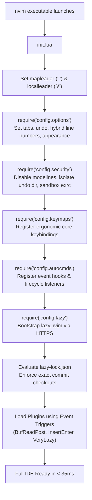

# Neovim IDE Architecture & Lifecycle

This document describes the internal structure, startup sequence, and lazy-loading architecture of this Neovim IDE configuration.

---

## 1. Directory Structure

```
dotfiles/
├── .gitignore
├── install.ps1                 # Windows automated installer
├── install.sh                  # POSIX (Linux/macOS) automated installer
├── README.md                   # Repository overview & quickstart
├── docs/
│   ├── ARCHITECTURE.md         # Configuration lifecycle & modular design
│   ├── KEYMAPS.md              # Complete keybinding table & cheatsheet
│   ├── LSP_FORMAT_LINT.md      # Language servers, Treesitter, formatting & linting
│   ├── OPTIONS.md              # Option-by-option rationale & settings
│   ├── PLUGINS.md              # Plugin ecosystem breakdown
│   └── SECURITY.md             # Threat modeling, CVE mitigations & hardening
└── nvim/
    ├── init.lua                # Clean entrypoint
    ├── lazy-lock.json          # Pinned Git commit hashes
    └── lua/
        ├── config/
        │   ├── autocmds.lua    # Event hooks (yank highlight, resize, close-with-q)
        │   ├── keymaps.lua     # Core ergonomic keybindings
        │   ├── lazy.lua        # Lazy.nvim bootstrap & security config
        │   ├── options.lua     # Editor options, tabs, undo & appearance
        │   └── security.lua    # Modeline mitigation, exrc sandbox & path permissions
        └── plugins/
            ├── completion.lua  # nvim-cmp, LuaSnip & snippets
            ├── dap.lua         # Interactive debugger (nvim-dap & dap-ui)
            ├── dashboard.lua   # Cyberpunk startup screen (alpha-nvim)
            ├── editor.lua      # which-key, autopairs, surround, comment, flash
            ├── explorer.lua    # Neo-tree file explorer & Oil.nvim
            ├── finder.lua      # Telescope fuzzy search & live grep
            ├── formatting.lua  # conform.nvim asynchronous format-on-save
            ├── git.lua         # gitsigns, lazygit, diffview & git-conflict
            ├── linting.lua     # nvim-lint static analysis
            ├── lsp.lua         # Mason, LSP servers, inlay hints & inc-rename
            ├── terminal.lua    # toggleterm floating & split terminals
            ├── treesitter.lua  # Syntax highlighting & AST text objects
            ├── trouble.lua     # Trouble.nvim diagnostics & symbol tree
            └── ui.lua          # Tokyo Night, dropbar, colorizer, neoscroll & lualine
```

---

## 2. Startup Lifecycle & Sequence



---

## 3. Lazy Loading Strategy

To ensure sub-50ms startup times, plugins are deferred until specifically needed using event triggers:

| Plugin Domain | Loading Trigger | Rationale |
| :--- | :--- | :--- |
| **Colorscheme (`tokyonight`)** | Eager (`lazy = false`, `priority = 1000`) | Must load before UI paints to avoid theme flickering. |
| **Statusline (`lualine`)** | `VeryLazy` | Statusline renders immediately after first screen paint. |
| **Buffer Tabs (`bufferline`)** | `VeryLazy` | Defer until initial window is rendered. |
| **File Tree (`neo-tree`)** | Keymap `<leader>e` or `:Neotree` | Tree window is only instantiated when requested. |
| **Directory Editor (`oil`)** | Keymap `-` or `Oil` | Loads only when browsing directories. |
| **Fuzzy Finder (`telescope`)** | Keymaps (`<leader>f*`, `<leader>g*`) | Heavy search modules defer until search is invoked. |
| **LSP Servers (`lspconfig`)** | `BufReadPre`, `BufNewFile` | Language servers only launch when opening actual source code files. |
| **Autocomplete (`nvim-cmp`)** | `InsertEnter` | Completion engine remains idle until the user starts typing in insert mode. |
| **Debugger (`nvim-dap`)** | Keymaps (`<F5>`, `<leader>d*`) | Debugging adapters never consume resources during ordinary editing. |
| **Terminal (`toggleterm`)** | Keymaps (`<C-\>`, `<leader>t*`) | Terminal subprocesses only spawn on explicit toggle. |

---

## 4. Cross-Platform Path Handling

- **Windows**:
  - Config location: `%LOCALAPPDATA%\nvim` (`C:\Users\<User>\AppData\Local\nvim`)
  - Data location: `%LOCALAPPDATA%\nvim-data`
  - Shell integration: Native PowerShell with RemoteSigned security policy.
- **Linux & macOS**:
  - Config location: `~/.config/nvim`
  - Data location: `~/.local/share/nvim`
  - Shell integration: Default user login shell (`/bin/bash` or `/bin/zsh`).
